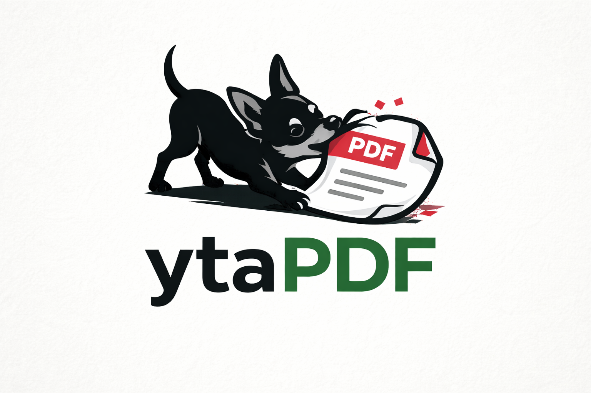
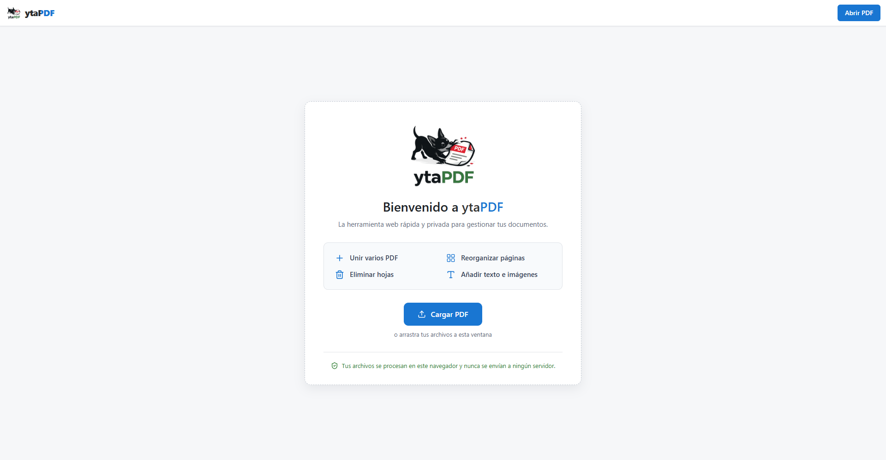
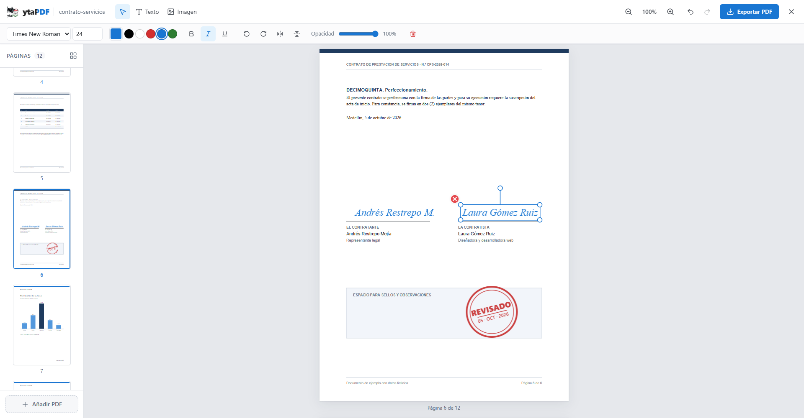
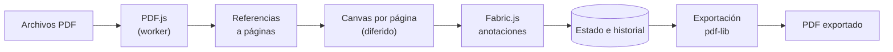

<div align="center">



# ytaPDF

Editor de PDF que se ejecuta entero en el navegador. Une, organiza, rellena, firma y anota documentos, y edita el texto que ya traen con su propia fuente. Los archivos no salen del equipo.

[ytapdf.vercel.app](https://ytapdf.vercel.app/)


</div>

## Contenido

- [Por qué existe](#por-qué-existe)
- [Funciones](#funciones)
- [Uso](#uso)
- [Cómo funciona](#cómo-funciona)
- [Desarrollo](#desarrollo)
- [Calidad del código](#calidad-del-código)
- [Despliegue](#despliegue)
- [Limitaciones conocidas](#limitaciones-conocidas)
- [Pendiente](#pendiente)
- [Licencia](#licencia)

## Por qué existe

Casi todos los editores de PDF en línea piden subir el documento a un servidor. Con un contrato, una historia clínica o una declaración de la renta, eso es un riesgo que ninguna política de privacidad elimina.

ytaPDF no tiene servidor. El documento se abre, se edita y se exporta en el navegador: no hay subida de archivos, ni cuentas, ni nada que borrar después. Vercel solo sirve archivos estáticos, incluidos los recursos que PDF.js y Tesseract necesitan, así que abrir un documento o reconocer su texto no hace peticiones a terceros. Una vez instalada como PWA, la aplicación funciona sin conexión.

El precio de no tener backend es que todo el trabajo con el PDF, incluido calcular dónde va cada elemento en el archivo final, ocurre en el cliente. [Cómo funciona](#cómo-funciona) explica las partes menos evidentes.

<div align="center">

<br/><br/>

<br/><br/>

</div>

## Funciones

### Editar

- **Texto del propio documento.** Un clic sobre un párrafo lo vuelve editable en su sitio. Al escribir, las líneas se reparten respetando la alineación original (también la justificada) y se reutiliza la fuente incrustada del PDF; solo los caracteres que le faltan se dibujan con una fuente parecida. El texto antiguo se elimina del contenido de la página, no se tapa.
- **Texto nuevo** con fuente, tamaño, color, negrita, cursiva, subrayado, tachado, alineación e interlineado. Además de Helvetica, Times y Courier, Noto Sans y Noto Serif se incrustan en el PDF y cubren griego, cirílico y latín ampliado. El chino, el japonés, el coreano y el árabe usan Noto Sans SC, KR y Arabic, que se descargan la primera vez que aparece uno de esos caracteres.
- **Imágenes** en cualquier formato que lea el navegador (PNG, JPG, WebP, GIF, SVG…), con la orientación EXIF de las fotos del móvil. Se pueden soltar sobre la página o pegar desde el portapapeles.
- **Firmas e iniciales** dibujadas, escritas con una letra manuscrita (Dancing Script, Great Vibes o Caveat) o tomadas de una foto de la firma en papel, de la que se separa la tinta. Las dibujadas y las escritas son trazados vectoriales. Se pueden guardar en el navegador para reutilizarlas.
- **Lápiz, formas y marcas**: trazos a mano alzada, rectángulos, elipses, líneas, flechas, resaltador, ✓, ✗ y la fecha de hoy. Cualquier objeto se puede repetir en todas las páginas en el mismo sitio.
- **Resaltar, subrayar y tachar** el texto seleccionado; cada marca se ajusta a las líneas que ocupa, también en páginas giradas.
- **Notas y enlaces** que se exportan como anotaciones reales del PDF: otros lectores muestran las notas como comentarios y siguen los enlaces a una web, un correo o una página del documento.
- **Censura real.** Al exportar, lo que queda bajo cada caja se elimina del contenido (letras, trazados, imágenes que caben dentro, enlaces y notas) y el resto de la página sigue siendo texto. Solo si hay una imagen o un campo de formulario a medio tapar, esa página se exporta como imagen.
- **Buscar, reemplazar y censurar.** `Ctrl+F` busca sin distinguir mayúsculas ni tildes; *Reemplazar todo* reescribe cada línea afectada con su propia fuente en un solo paso deshacer, y *Censurar todo* tapa cada coincidencia con una caja ajustada a sus letras.
- **OCR local** en español e inglés con Tesseract. El texto reconocido se busca, se copia y se censura como el resto, y al exportar se añade como texto invisible sobre cada palabra.
- **Formularios** del propio PDF (texto, casillas, opciones y listas) rellenados sobre la página.
- **Organización de objetos**: capas, alinear, distribuir, agrupar, bloquear, duplicar, copiar y pegar entre páginas, guías de alineación y posición y tamaño exactos en milímetros.

### Documento

- **Empezar sin PDF** con un documento en blanco (A4, Carta u Oficio) o convirtiendo imágenes en páginas.
- **Unir** varios PDF e insertarlos en una posición concreta, también soltándolos entre dos páginas del organizador.
- **Organizador** con arrastrar y soltar y selección múltiple: mover varias páginas juntas, duplicar, girar, invertir el orden, eliminar, insertar páginas en blanco, PDF o imágenes y exportar solo algunas.
- **Dividir** por rangos (`1-3, 4-8, 9-`), cada N páginas o una página por archivo; varios archivos salen en un ZIP.
- **Girar y recortar** páginas. Las anotaciones giran y se desplazan con ellas.
- **Numeración, encabezado, pie y marca de agua**, visibles en el editor mientras se ajustan.
- **Marcadores** que siguen a sus páginas al reordenarlas y se escriben en el PDF exportado.
- **Historial** de deshacer y rehacer para anotaciones, formularios y cambios de páginas.
- **Guardar como** con nombre, páginas, contraseña (AES-256), firma digital, reducción de tamaño, aplanado de formularios y edición o eliminación de metadatos. Desde el mismo diálogo se imprime o se comparte.
- **Firma digital** con un certificado `.p12` o `.pfx` de clave RSA: firma CMS separada con SHA-256 (`adbe.pkcs7.detached`) que Acrobat y otros lectores validan. El certificado y su contraseña solo están en memoria.
- **Reducir el tamaño** recomprimiendo las fotos JPEG que tienen más resolución de la necesaria y eliminando objetos sin usar.
- **Páginas como imagen** en PNG o JPG a 72, 150 o 300 ppp, con sus anotaciones.
- **Documentos cifrados**: se pide la contraseña al abrirlos y se exportan con su contenido.

### Aplicación

- **PWA instalable** que abre, edita y exporta sin conexión. Instalada, abre PDF desde el sistema operativo y, en Chrome y Edge, guarda sobre el mismo archivo tras confirmarlo una vez. En Android recibe PDF e imágenes desde el menú *Compartir*.
- **Trabajos guardados** en el navegador y **proyectos** `.ytapdf` para continuar en otro momento o en otro equipo. Opcionalmente, una copia de recuperación por si la pestaña se cierra por error.
- **IA en el dispositivo** (opcional) para resumir o traducir con las API integradas de Chrome 138+ de escritorio, que ejecutan el modelo en el equipo. Donde no existen, la función lo indica.
- Interfaz en **español e inglés**, tema claro, oscuro o del sistema, atajos de teclado (`?` los muestra) y diseño adaptado a pantallas pequeñas, con zoom por pellizco.
- Solo se dibujan las páginas cercanas a la vista, y pdf-lib y las fuentes se descargan cuando hacen falta.

## Uso

1. **Abrir.** *Cargar PDF* o arrastrar uno o varios archivos a la ventana. Sin PDF, *Documento en blanco* o *Imágenes a PDF*.
2. **Editar el texto del documento** con *Editar texto* (`E`): clic en un párrafo, o `Alt` + clic para una sola línea. *Restaurar original* deshace los cambios de ese texto.
3. **Anotar** con las herramientas de la barra: texto, imagen, firma, sellos, lápiz y formas (incluidas notas, enlaces, resaltador y censura). La fila de propiedades cambia el estilo, el giro, la opacidad, las capas y el bloqueo de lo seleccionado.
4. **Organizar** desde el panel de páginas con *Organizar páginas*. Doble clic en una página vuelve a ella en el editor.
5. **Exportar** con *Exportar PDF*, que descarga `<nombre>_ytaPDF.pdf`. La flecha junto al botón abre *Guardar como*, *Exportar como imagen*, *Imprimir* y *Compartir*. Si el archivo se abrió con la aplicación instalada, o se guardó con *Guardar como* en Chrome o Edge, el botón pasa a ser *Guardar*.

El menú ⋮ reúne el OCR, la numeración y la marca de agua, la IA, guardar el trabajo en el navegador, el idioma y el tema.

<details>
<summary><b>Atajos de teclado</b></summary>

<br/>

| Atajo | Acción |
|---|---|
| `T` / `V` | Herramienta de texto / selección |
| `E` | Editar el texto del documento |
| `P` | Lápiz |
| `S` | Seleccionar el texto del documento |
| `C` | Recortar (`Intro` aplica, `Esc` cancela) |
| `Alt` + clic | Editar solo una línea de un párrafo |
| `Supr` o `Retroceso` | Eliminar lo seleccionado |
| Flechas (`Mayús` + flechas) | Mover 1 px (10 px) |
| `Alt` al arrastrar | Mover sin guías de alineación |
| `Esc` | Terminar la edición y deseleccionar |
| `Ctrl+Z` / `Ctrl+Y` (o `Ctrl+Mayús+Z`) | Deshacer / rehacer |
| `Ctrl+C` / `Ctrl+X` / `Ctrl+V` | Copiar, cortar y pegar (también imágenes y texto de otras aplicaciones) |
| `Ctrl+D` | Duplicar |
| `Ctrl+L` | Bloquear o desbloquear |
| `Ctrl+Mayús+G` | Agrupar o desagrupar |
| `Ctrl+]` / `Ctrl+[` (o `Ctrl+↑` / `Ctrl+↓`) | Traer adelante / enviar atrás |
| `Ctrl+Mayús+]` / `Ctrl+Mayús+[` | Traer al frente / enviar al fondo |
| `Ctrl +` / `Ctrl -` / `Ctrl 0` | Acercar / alejar / 100 % |
| `Ctrl` + rueda, o pellizcar | Zoom continuo |
| `Ctrl+S` | Exportar PDF, o guardar sobre el archivo abierto |
| `Ctrl+Mayús+S` | Guardar como |
| `Ctrl+P` | Imprimir |
| `Ctrl+F` | Buscar (`Intro` / `Mayús+Intro` para la siguiente o la anterior) |
| `Ctrl+G` | Ir a una página |
| `Ctrl+O` | Abrir o añadir PDF |
| `?` | Mostrar los atajos |

En el organizador, `Ctrl+A` selecciona todas las páginas, `Ctrl+D` duplica las seleccionadas y `Supr` las elimina. En macOS, `Cmd` sustituye a `Ctrl`.

</details>

## Cómo funciona

### Del lienzo al PDF

El lienzo de edición y el PDF usan sistemas de coordenadas distintos, y la exportación tiene que traducir entre ellos sin perder precisión:

| | Lienzo (Fabric.js) | PDF |
|---|---|---|
| Origen | Esquina superior izquierda | Esquina inferior izquierda |
| Eje Y | Hacia abajo | Hacia arriba |
| Unidad | Píxeles del viewport | Puntos tipográficos |
| Ancla del texto | Caja de la línea | Línea base |
| Rotación de página | Ya aplicada en lo que se ve | Declarada aparte en `/Rotate` |
| Origen de página | Siempre en cero | Desplazado por el `CropBox` |

En lugar de recalcular coordenadas a mano, la exportación compone dos matrices que ya existen: `calcTransformMatrix()` de Fabric (objeto → lienzo, con posición, ángulo, escala y volteo) y la inversa de `viewport.transform` de PDF.js a escala 1 (lienzo → PDF, con rotación, `CropBox` y `UserUnit`). `src/lib/geometry.ts` las combina y `src/lib/export/drawing.ts` aplica el resultado con un único operador `cm` por objeto. Son las mismas matrices que se usaron para mostrar la página, así que no hay casos especiales por rotación ni errores que se acumulen.

El texto necesita un paso más, porque Fabric coloca cada línea por su caja y el PDF dibuja desde la línea base. La exportación reconstruye los objetos con Fabric y lee de él la base de cada renglón:

```ts
baseline = topOffset + alturaDeRenglonesAnteriores + alturaDeLinea * (1 - _fontSizeFraction);
```

Las fuentes estándar del lienzo son métricamente compatibles con las del PDF (Liberation Sans con Helvetica, por ejemplo) y Noto usa en pantalla el mismo archivo que se incrusta, de modo que los anchos coinciden. Las líneas, flechas, rectángulos y elipses mantienen el grosor del trazo al escalarse: se dibujan sin la escala del objeto, con su tamaño real.

### Editar el texto que trae el PDF

Un PDF no guarda párrafos, sino órdenes para dibujar glifos en posiciones fijas (`BT /F3 11 Tf … [(Hol) -20 (a)] TJ ET`). Editarlo sin tapar con rectángulos blancos exige leer esas órdenes, quitar las del texto viejo y escribir el nuevo con la misma fuente. `src/lib/pdfText/` lo hace en cinco pasos:

1. **Leer.** Un lector del contenido (`lexer.ts`) guarda la posición en bytes de cada operación, incluidas las imágenes en línea. El intérprete (`interpreter.ts`) sigue las matrices de texto y de objeto, el espaciado (`Tc`, `Tw`, `Tz`, `TL`, `Ts`), el color y la opacidad, entra en los formularios XObject y calcula dónde cae cada glifo. Para eso necesita entender la fuente (`fonts.ts`, `cmap.ts`, `encodings.ts`): cuántos bytes ocupa cada código, cuánto avanza y qué carácter representa, a partir de `ToUnicode`, las codificaciones con `Differences` o el propio programa de la fuente.
2. **Agrupar.** `layout.ts` ordena los glifos por geometría y no por orden de dibujo: forma líneas, deduce los espacios que representa el interletraje y agrupa párrafos que comparten tamaño, interlineado y alineación. El texto justificado se reconoce porque sus espacios están estirados.
3. **Editar.** El párrafo se convierte en un texto de Fabric que mide cada carácter con los anchos de la fuente del PDF, así que se reparte y justifica igual que en el archivo final. Cada carácter recuerda de qué fuente vino.
4. **Borrar.** Cada glifo tiene una clave estable. Los editados se quitan de su `Tj`/`TJ` y se sustituyen por un desplazamiento del mismo ancho, de modo que el resto de la línea no se mueve. Si el texto está en un XObject compartido, se dibuja una copia modificada solo en esa página (`apply.ts`).
5. **Escribir.** El texto nuevo se dibuja justo después del bloque original, con lo que hereda su recorte y su orden de capas. Los glifos que el subconjunto incrustado no tiene se comprueban en el propio programa de la fuente y se dibujan con la fuente estándar más parecida, avisando al exportar.

La vista previa del editor es el resultado real: un *web worker* (`textWorker.ts`) aplica los cambios y los añade al documento como una actualización incremental, que PDF.js dibuja como cualquier otra página.

### Modelo del documento



Los originales no se reescriben mientras se edita. El documento es una lista de referencias a páginas (archivo de origen, índice, rotación y recorte), así que reordenar, girar o unir solo cambia esa lista. Cada estado del historial es una instantánea inmutable que comparte estructura con la anterior, y deshacer es barato incluso en documentos grandes. Un `IntersectionObserver` decide qué páginas tienen canvas e instancia de Fabric; las demás liberan su memoria. Las anotaciones se guardan como JSON de Fabric en unidades de la página, independientes del zoom.

Al exportar se elige la estrategia que más conserva: si el documento mantiene sus páginas y su orden, se modifica en sitio y conserva formularios, marcadores, enlaces y metadatos; si no, las páginas se copian a un documento nuevo y se vuelven a enlazar sus campos de formulario. Después se aplican la censura, las anotaciones, el texto reconocido, las notas y los enlaces, los metadatos, la recompresión y, por último, el cifrado o la firma. Antes de guardar se eliminan los objetos inalcanzables, porque pdf-lib escribiría cualquier objeto que conserve.

<details>
<summary><b>Otros subsistemas</b></summary>

<br/>

- **Censura.** El intérprete devuelve cada glifo con su caja y cada trazado o imagen con su contorno. Las cajas de censura se pasan al espacio del PDF y se cortan como polígonos convexos (pueden estar giradas): se borran los glifos que quedan al menos un 20 % bajo una caja, los trazados e imágenes que caben dentro dejan de pintarse y se retiran los enlaces y notas de debajo. Si una imagen o un campo de formulario queda a medio tapar, o el contenido usa una compresión que no se puede reescribir, la exportación repite esa página como imagen. También se quita el texto de sustitución (`/ActualText`, `/Alt`) de las secuencias marcadas que contenían algo borrado.
- **Recorte.** La página guarda su nuevo `CropBox` y PDF.js construye la vista con esa caja, así que el lienzo, la capa de texto y la exportación usan la misma geometría.
- **Formularios.** PDF.js dibuja los campos con los valores de su almacén de anotaciones; encima hay controles HTML transparentes que solo se ven al escribir. Si un valor usa caracteres que Helvetica no tiene, el campo se dibuja con Noto Sans.
- **Búsqueda.** El texto de cada página se normaliza (sin mayúsculas, tildes ni ligaduras) guardando la posición original de cada carácter, para resaltar el tramo exacto en la capa de texto de PDF.js.
- **OCR.** Tesseract (WebAssembly) se carga al usarlo desde `/tesseract/`, con el núcleo LSTM adecuado a la CPU y los datos de español e inglés copiados al compilar. La página se dibuja a 300 ppp y cada palabra se guarda en el espacio del PDF de su página de origen, así que sigue en su sitio si la página se gira o se recorta.
- **Firma digital.** Se reserva un hueco de 16 KB en un campo de firma invisible, se guarda el PDF sin flujos de objetos, se calcula el `ByteRange` y node-forge firma el resumen SHA-256 de todo el archivo menos ese hueco.
- **Reducción de tamaño.** El intérprete averigua el mayor tamaño al que se dibuja cada imagen. Las JPEG de 8 bits en RGB o gris se recodifican con el navegador a la resolución justa y solo se sustituyen si ocupan al menos un 10 % menos.
- **Alfabetos.** Las pilas CSS terminan en Noto Sans Arabic, SC y KR. Al exportar, cada línea se parte en tramos que una sola fuente puede dibujar, y fontkit da forma al árabe.
- **IA.** Las API de Chrome se detectan sin suponer que existen y su disponibilidad se consulta con un tiempo límite, porque algunas compilaciones las exponen sin el servicio que las respalda. Los textos largos se resumen por trozos y después se resumen los resúmenes.
- **Idiomas.** Los textos se escriben en español y sirven de clave: `t("Guardar")` devuelve la traducción o, si falta, el propio texto. Una prueba comprueba que toda la interfaz tiene traducción al inglés con sus marcadores.
- **PWA.** Cada compilación genera `sw.js` con la lista exacta de sus archivos. Cuando hay una versión nueva, la aplicación lo avisa en lugar de recargarse sola. La recuperación del trabajo guarda en IndexedDB los originales, las anotaciones, los formularios y las imágenes, nunca las contraseñas.

</details>

<details>
<summary><b>Organización del código</b></summary>

<br/>

```
vite.config.ts                 Plugins: recursos de PDF.js y Tesseract, service worker, Vitest
src/
├── App.svelte, main.ts        Distribución, archivos soltados o pegados, atajos, montaje
├── sw.js                      Plantilla del service worker
└── lib/
    ├── editor.svelte.ts       Estado global: páginas, historial, exportación, trabajos guardados
    ├── fabricSetup.ts         Controles, formas, capas, bloqueo, guías y portapapeles del lienzo
    ├── nativeText.ts          Texto del documento editable en Fabric y su descripción para el PDF
    ├── pdfjs.ts               Carga, renderizado y campos de formulario con PDF.js
    ├── geometry.ts            Matrices y trazados
    ├── search.svelte.ts, textSearch.ts, textReplace.ts, textMarks.ts
    ├── ocr.ts, ocrText.ts     OCR y texto reconocido
    ├── decorations.ts, crop.ts, arrange.ts, outline.ts, annotationTransforms.ts
    ├── fonts.ts, embeddedFonts.ts
    ├── images.ts, imagePdf.ts, blankPdf.ts, thumbnails.ts
    ├── signatures.ts, typedSignature.ts, signaturePhoto.ts
    ├── session.ts, project.ts, zip.ts, deliver.ts, pwa.svelte.ts
    ├── i18n.svelte.ts, locales/en.ts, theme.svelte.ts, notifications.svelte.ts
    ├── localAi.ts, links.ts, pageRanges.ts, polygon.ts, compression.ts
    ├── pdfText/               Edición del texto original del PDF
    │   ├── lexer.ts, interpreter.ts, fonts.ts, cmap.ts, encodings.ts
    │   ├── layout.ts, analyze.ts, apply.ts, incremental.ts
    │   └── textDocument.ts, textWorker.ts, service.ts
    ├── export/                Exportación
    │   ├── index.ts           Orquestación y opciones
    │   ├── assemble.ts        Documento de salida, formularios, metadatos y cifrado
    │   ├── drawing.ts, fabricDrawables.ts
    │   ├── redact.ts, raster.ts, ocrLayer.ts, pdfAnnotations.ts
    │   ├── compress.ts, sign.ts, outline.ts
    │   └── fixtures/          Certificados de prueba autofirmados
    └── components/            Componentes de Svelte (barra, páginas, organizador, diálogos)
```

Las pruebas (`*.test.ts`) están junto al código que comprueban.

</details>

### Stack

| Capa | Tecnología |
|---|---|
| Interfaz | Svelte 5 (runas), TypeScript 5.9, lucide-svelte |
| Compilación | Vite 7 |
| Lectura y renderizado de PDF | PDF.js 6.3 |
| Escritura de PDF | @cantoo/pdf-lib 2.11 (variante mantenida de pdf-lib, con cifrado) y @cantoo/fontkit |
| Lienzo de edición | Fabric.js 7 |
| OCR | tesseract.js 7 |
| Firma digital | node-forge |
| Fuentes | Noto Sans, Noto Serif, Noto Sans SC, KR y Arabic; Dancing Script, Great Vibes y Caveat (OFL) |
| Pruebas | Vitest 5 con cobertura V8, jsdom y node-canvas |
| Análisis estático | SonarQube |
| Alojamiento | Vercel (sitio estático) |

## Desarrollo

Requiere **Node.js 22.13 o superior** (o 24 LTS), como exigen PDF.js 6 y Vitest 5.

```bash
git clone https://github.com/juanitomanoplateada/ytaPDF.git
cd ytaPDF
npm install
npm run dev
```

La aplicación queda en `http://localhost:5173`.

| Comando | Qué hace |
|---|---|
| `npm run dev` | Servidor de desarrollo |
| `npm run build` | Compilación de producción en `dist/` |
| `npm run preview` | Sirve la compilación en `http://localhost:4173` |
| `npm run check` | Tipos con `svelte-check` y `tsc` (aplicación, configuración y pruebas) |
| `npm test` | Pruebas con Vitest |
| `npm run test:coverage` | Pruebas con cobertura; informe LCOV en `coverage/ytaPDF/` |

Antes de proponer un cambio deben pasar `npm run check`, `npm test` y `npm run build`.

## Calidad del código

### Pruebas

La suite (unos 580 casos en 47 archivos) corre en Node sin navegador. Los módulos que dependen del DOM, como el lienzo de Fabric, el texto editable o la exportación de anotaciones, se prueban con jsdom y node-canvas (`// @vitest-environment jsdom`), y las dependencias del navegador que Node no tiene (IndexedDB, Web Workers, Tesseract, las API de IA de Chrome, el selector de archivos) se sustituyen por dobles en cada prueba.

Las pruebas que más protegen son las de punta a punta: generan PDF con pdf-lib, aplican las operaciones del editor y comprueban el resultado leyéndolo con PDF.js. Entre otras cosas verifican la posición y dirección del texto en páginas giradas y recortadas, que la censura no deje restos en el archivo, que la firma CMS se verifique con el certificado, que el cifrado solo abra con la contraseña correcta, que el texto editado se reescriba con su fuente sin mover el resto de la línea y que cada texto de la interfaz tenga traducción.

### Cobertura

La cobertura de `src/**/*.{ts,js}` es del **100 % de líneas y ramas**. Los componentes `.svelte` quedan fuera de la medición, igual que en SonarQube, que no los analiza. Cuando una rama no se podía alcanzar desde ninguna entrada real, se ha simplificado el código en lugar de añadir comentarios para que el informe la ignore.

### SonarQube

El análisis se ejecuta contra una instancia local:

```bash
npm run test:coverage
npx sonar-scanner
```

La configuración vive en `sonar-project.properties`, que no se versiona porque lleva el token de análisis. Declara `src` como código y pruebas, separa los `*.test.ts` como pruebas y lee la cobertura de `coverage/ytaPDF/lcov.info`. En una canalización, el token debe llegar por la variable de entorno `SONAR_TOKEN`. El estado actual del proyecto es cobertura del 100 %, sin puntos sensibles de seguridad, sin incidencias abiertas y con la puerta de calidad superada.

### Archivos no versionados

`.gitignore` excluye dependencias, compilados, cachés de Vite, informes de cobertura, la configuración y la carpeta de trabajo de SonarQube, variables de entorno, la carpeta de Vercel, los PDF exportados durante las pruebas manuales (`*_ytaPDF.pdf`) y la configuración de editores, asistentes de código y sistema operativo.

## Despliegue

Es un sitio estático: no necesita servidor ni variables de entorno. En Vercel basta la configuración por defecto para Vite.

| Ajuste | Valor |
|---|---|
| Framework | Vite |
| Compilación | `npm run build` |
| Salida | `dist` |
| Node.js | 22.x o 24.x |

El plugin `pdfjs-assets` copia en `dist/pdfjs/` las CMaps, las fuentes estándar, los decodificadores WASM y los perfiles ICC de PDF.js. `tesseract-assets` copia en `dist/tesseract/` el trabajador, los núcleos y los datos de español e inglés (unos 17 MB en total; cada equipo descarga unos 6 MB la primera vez que usa el OCR). El código se divide en fragmentos (`pdfjs`, `fabric`, `pdf-lib`), y pdf-lib y las fuentes Noto solo se descargan al usarse. El plugin `service-worker` genera `dist/sw.js` en cada compilación, y la aplicación avisa a los usuarios de la versión nueva en su siguiente visita.

Funciona en las versiones recientes de Chrome, Edge, Firefox y Safari, de escritorio y móviles.

## Limitaciones conocidas

Afectan al resultado exportado, por eso se detallan.

**Texto y fuentes**

- Helvetica, Times y Courier son las fuentes estándar del PDF: no se incrustan y usan WinAnsi, que cubre el español pero no otros alfabetos. Los símbolos sin equivalente se sustituyen por uno legible (`→` por `->`, `≤` por `<=`) y la aplicación avisa. Para otros alfabetos están Noto Sans y Noto Serif.
- Noto Sans SC y KR pesan unos 10 y 6 MB y se descargan la primera vez que hacen falta. Chino, japonés y coreano tienen un solo grosor. En una línea que mezcla árabe y latín, los tramos siguen el orden de izquierda a derecha. No hay emoji.
- *Editar texto* funciona con PDF digitales (Word, LibreOffice, navegadores, programas de maquetación). No admite documentos escaneados, texto convertido en trazados, texto vertical, fuentes sin información de caracteres ni CMaps predefinidas distintas de `Identity`. Las líneas se reacomodan dentro del párrafo editado, pero si el texto crece no empuja lo que hay debajo. Cambiar el texto invalida las firmas digitales que tuviera el documento.
- La búsqueda usa el texto original: lo cambiado con *Editar texto* no se resalta, aunque *Reemplazar todo* sí lo cambia. Una coincidencia partida entre dos líneas no se reemplaza ni se censura.

**Censura y recorte**

- Un trazado que asoma fuera de la caja (un fondo, una tabla, texto convertido en curvas) se conserva entero, oculto por la caja. Con una imagen a medio tapar o un campo de formulario sin aplanar, la página sale como imagen a 200 ppp y su texto deja de ser seleccionable, salvo el reconocido por OCR. La numeración, el encabezado y la marca de agua no se cortan.
- Recortar oculta lo que queda fuera, pero el contenido sigue en el archivo. Para eliminar información, hay que censurarla.

**OCR**

- Español e inglés. Va bien con escaneos limpios y rectos; las fotos torcidas o de poca resolución dan peores resultados. Tarda unos segundos por página y el texto reconocido no se puede editar con *Editar texto*.

**Exportación y seguridad**

- La firma digital admite certificados `.p12`/`.pfx` con clave RSA (no de curva elíptica). Es invisible, sin sello de tiempo de un servidor externo, y no se combina con la contraseña. Los lectores solo la dan por válida si confían en la autoridad que emitió el certificado.
- Las firmas dibujadas, escritas o tomadas de una foto son la imagen de una firma. Para validez electrónica, hay que usar la firma con certificado.
- Un documento protegido se exporta sin protección salvo que se le ponga contraseña en *Guardar como*. Esa contraseña abre el archivo con todos los permisos: impide que otros lo lean, no que quien la tenga lo imprima o lo copie.
- *Reducir el tamaño* solo recomprime fotos JPEG en RGB o gris; no toca PNG, escaneos en blanco y negro ni JPEG en CMYK.
- Al unir o reordenar, el documento nuevo conserva contenido, anotaciones y campos de formulario, pero no los marcadores ni las etiquetas de estructura del original. Si solo se anota, se conserva todo.
- Se rellenan campos de texto, casillas, botones de opción y listas. Los campos de firma, los botones con acciones y los formularios XFA no se editan.
- Los proyectos y los trabajos guardados contienen los PDF originales tal cual, sin cifrar si no lo estaban.

**Navegador**

- Guardar sobre el mismo archivo requiere la API de acceso a archivos (Chrome y Edge de escritorio); en los demás, *Guardar como* descarga una copia.
- Si el navegador no puede imprimir desde un marco oculto, el PDF se abre en una pestaña nueva. *Compartir* solo aparece donde el navegador permite compartir archivos.
- Recibir archivos desde el menú *Compartir* funciona en Android con la aplicación instalada desde Chrome o Edge.
- La IA en el dispositivo depende de Chrome 138+ de escritorio y del hardware que exige su modelo. Los resúmenes se escriben en español, inglés, francés, alemán o japonés, y la traducción se muestra en el diálogo sin reescribir el PDF.
- Sin conexión, las fuentes Noto y los recursos de PDF.js para documentos poco comunes (CJK, JPEG 2000) solo están disponibles si ya se usaron antes.

## Pendiente

- Firma digital con claves de curva elíptica, firma visible y sello de tiempo.
- Censurar la parte tapada de una imagen sin convertir la página en imagen.
- Pruebas de interfaz en un navegador real e integración continua que ejecute las pruebas y el análisis de SonarQube.

## Licencia

Pendiente de definir. Hasta entonces, todos los derechos reservados.
