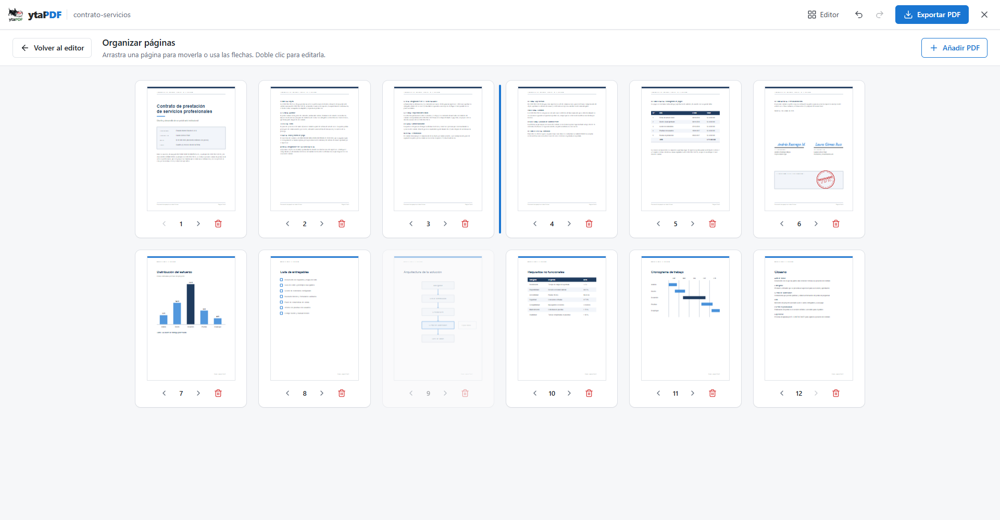
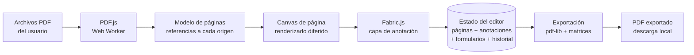

<div align="center">


# ytaPDF

**Editor de PDF que funciona íntegramente en el navegador.**

Une, organiza, firma, rellena y anota documentos con texto, imágenes y formas, **edita el texto que ya trae el PDF** con su propia fuente, y expórtalos conservando la posición exacta de cada elemento. Ningún archivo sale de tu equipo, y funciona incluso sin conexión.

<br/>

[](https://svelte.dev/)
[](https://www.typescriptlang.org/)
[](https://vite.dev/)
[](https://ytapdf.vercel.app/)


-2.11-009688?style=flat-square)


<br/>

**[ytapdf.vercel.app](https://ytapdf.vercel.app/)**

<br/>

[Características](#características) &nbsp;·&nbsp;
[Uso](#uso) &nbsp;·&nbsp;
[El problema técnico](#el-problema-técnico) &nbsp;·&nbsp;
[Arquitectura](#arquitectura) &nbsp;·&nbsp;
[Desarrollo](#desarrollo) &nbsp;·&nbsp;
[Despliegue](#despliegue) &nbsp;·&nbsp;
[Limitaciones](#limitaciones-conocidas)

</div>

---

## Sobre el proyecto

Editar un PDF suele implicar subirlo a un servidor ajeno. Para un contrato, una historia clínica o una declaración de renta, eso es un problema que ninguna política de privacidad resuelve del todo.

**ytaPDF** no tiene servidor. El documento se abre, se edita y se exporta dentro del navegador: no hay carga de archivos, no hay cuenta de usuario y no hay nada que borrar después. El despliegue en Vercel sirve archivos estáticos y nada más, incluidos los recursos que PDF.js necesita para fuentes y decodificadores, de modo que abrir un documento no genera ninguna petición a terceros.

La contrapartida de trabajar sin backend es que toda la manipulación del PDF —incluido el cálculo de dónde va cada elemento en el documento final— ocurre en el cliente. La sección [El problema técnico](#el-problema-técnico) explica la parte menos evidente de eso.

<div align="center">

<br/><br/>

<br/><br/>

</div>

---

## Características

**Edición**

| | |
|---|---|
| **Texto del documento** | Edita el texto que ya trae el PDF: un clic sobre un párrafo lo vuelve editable y, al escribir, sus líneas se vuelven a repartir respetando la alineación original (izquierda, centrada, derecha o justificada). Se reutiliza la **fuente incrustada del propio documento** y, si le falta algún carácter, solo ese se dibuja con una fuente parecida. El texto original se elimina del archivo, no se tapa. |
| **Texto** | Texto de varias líneas con fuente, tamaño, color, negrita, cursiva, subrayado y tachado, alineado a la izquierda, centrado o a la derecha y con el interlineado que se elija. Además de Helvetica, Times y Courier, incluye **Noto Sans** y **Noto Serif**, que se incrustan en el PDF y admiten griego, cirílico y otros alfabetos latinos ampliados. El **chino, el japonés, el coreano y el árabe** (con sus letras enlazadas) se escriben con Noto Sans SC, KR y Arabic, que se descargan solo cuando aparece uno de esos caracteres. |
| **Imágenes** | PNG, JPG, WebP, GIF, SVG y cualquier formato que el navegador sepa leer. Las fotos de móvil respetan su orientación EXIF. Se pueden soltar sobre una página o pegar desde el portapapeles. |
| **Firmas e iniciales** | Se **dibujan** con ratón, dedo o lápiz; se **escriben** con una de tres letras manuscritas (Dancing Script, Great Vibes, Caveat), o se toman **de una foto** de la firma en papel, a la que se quita el fondo para dejar solo la tinta. Las dibujadas y escritas se insertan como trazado vectorial, nítido a cualquier zoom. Firmas e iniciales se pueden guardar en el navegador para reutilizarlas. |
| **Lápiz** | Dibujo a mano alzada sobre la página con el color y el grosor de la barra. Cada trazo es un objeto vectorial que se puede mover, recolorear o borrar. |
| **Sellos y marcas** | Marca de verificación ✓, cruz ✗ y la fecha de hoy, para rellenar casillas de documentos que no tienen formulario. Cualquier objeto seleccionado se puede **añadir a todas las páginas** en el mismo sitio. |
| **Formas y resaltado** | Rectángulos, elipses, líneas y flechas con color, relleno y grosor; resaltador translúcido en varios colores. Con `Mayús`, cuadrados, círculos y ángulos de 45°. |
| **Seleccionar, copiar y buscar texto** | La herramienta *Seleccionar texto* permite seleccionar y copiar el texto del documento como en un visor. `Ctrl+F` busca en todas las páginas sin distinguir mayúsculas ni tildes, resalta cada coincidencia sobre la página y salta de una a otra. |
| **Buscar y reemplazar** | Desde la barra de búsqueda, *Reemplazar todo* cambia un texto en todo el documento con el motor de edición de texto: cada línea afectada se reescribe con su propia fuente, y el cambio se deshace en un solo paso. *Censurar todo* tapa cada coincidencia con una zona de censura ajustada a sus letras. |
| **OCR local** | Reconoce el texto de las páginas escaneadas en español o inglés con Tesseract, ejecutado en el navegador y servido desde el propio sitio. El texto reconocido se busca, se selecciona, se copia y se censura como el resto, y al exportar se añade como **texto invisible** sobre cada palabra, así que el PDF también se puede buscar en otros lectores. |
| **Notas y enlaces** | Las notas y los enlaces se exportan como **anotaciones reales del PDF**: otros lectores muestran las notas como comentarios que se abren y se editan, y los enlaces llevan a una dirección web, un correo o una página del documento. |
| **Resaltar, subrayar y tachar el texto** | Sobre el texto seleccionado, cada marca se ajusta a las líneas que ocupa, también en páginas giradas. Son objetos normales: se pueden recolorear, mover o borrar. |
| **Alinear, distribuir y agrupar** | Alinea varios objetos entre sí (o uno con la página), distribúyelos con huecos iguales y agrúpalos para moverlos juntos (`Ctrl+Mayús+G`). La posición y el tamaño se pueden escribir en milímetros, manteniendo o no las proporciones. |
| **Censura real** | Tapa información sensible. Al exportar, lo que queda bajo la caja se **elimina del contenido de la página** (letras, trazados e imágenes que quepan dentro, enlaces y notas) y el resto de la página sigue siendo texto seleccionable. Solo si hay una imagen o un campo de formulario a medio tapar, esa página se exporta como imagen. Nada de lo censurado queda en el archivo, ni siquiera como objeto sin usar. |
| **Capas** | Traer al frente, traer adelante, enviar atrás y enviar al fondo, también con selección múltiple. El orden se respeta en el PDF. |
| **Edición rápida** | Duplicar, copiar y pegar entre páginas, bloquear objetos para no moverlos sin querer y guías de alineación con los bordes y el centro de la página y de otros objetos. |
| **Formularios** | Los campos del propio PDF (texto, casillas, opciones y listas) se rellenan directamente sobre la página y se guardan en el archivo exportado. |

**Documento**

| | |
|---|---|
| **Empezar sin PDF** | Crea un documento en blanco (A4, Carta u Oficio, en vertical u horizontal) o **convierte imágenes en PDF**: cada imagen es una página con sus proporciones, sobre la que se puede escribir y firmar. |
| **Unión de documentos** | Carga varios PDF a la vez, o añádelos después, y trabájalos como uno solo. Se pueden **insertar en una posición concreta**, también soltándolos entre dos páginas del organizador. |
| **Organizador visual** | Cuadrícula con arrastrar y soltar y selección múltiple (`Ctrl` / `Mayús` + clic). Con varias páginas seleccionadas, el arrastre **las mueve juntas**. Duplica, gira a la izquierda o a la derecha, invierte el orden, elimina o **exporta solo algunas páginas**, e inserta páginas en blanco, PDF o imágenes donde haga falta. |
| **Dividir** | Separa el documento en varios PDF por rangos (`1-3, 4-8, 9-`), cada cierto número de páginas o una página por archivo. Varios archivos se descargan juntos en un ZIP. |
| **Rotación y recorte** | Gira páginas en pasos de 90° y **recórtalas** dibujando la zona que quieres conservar, en una página o en todas con los mismos márgenes. Las anotaciones giran y se desplazan con la página. |
| **Numeración, encabezado y marca de agua** | Números de página con formato y posición a elegir, encabezado y pie con el nombre del documento o la fecha, y una marca de agua en diagonal. Se ven en el editor mientras se ajustan y se exportan igual. |
| **Marcadores** | Panel con el índice del documento. Al unir varios PDF, cada archivo tiene su marcador con los suyos dentro, y los marcadores siguen a sus páginas al reordenarlas y se escriben en el PDF exportado. |
| **Historial completo** | Deshacer y rehacer cubre anotaciones, formularios y cambios de páginas (`Ctrl+Z` / `Ctrl+Y`). |
| **Exportación fiel** | Cada elemento conserva en el PDF su posición, ángulo, escala y volteo exactos, también en páginas rotadas o recortadas. |
| **Guardar como** | Nombre de archivo editable, páginas a exportar, **contraseña** (cifrado AES-256), **firma digital**, **reducción de tamaño**, **aplanado de formularios** y propiedades del documento: se pueden editar el título, el autor, el asunto y las palabras clave, o quitar todos los metadatos antes de compartirlo. Desde el mismo diálogo se imprime o se comparte. |
| **Firma digital** | Firma el PDF con tu certificado (`.p12` o `.pfx`, clave RSA): firma CMS separada con SHA-256 (`adbe.pkcs7.detached`), que Acrobat y otros lectores validan y que deja de ser válida si el archivo cambia. El certificado y su contraseña solo se usan en memoria. |
| **Reducir el tamaño** | Recomprime las fotos JPEG del documento y baja su resolución cuando es mayor de la necesaria para el tamaño al que se ven (tres niveles), y elimina los objetos que nadie usa. El texto y los dibujos no cambian. |
| **Páginas como imagen** | Exporta páginas en PNG o JPG a 72, 150 o 300 ppp, con sus anotaciones. Varias páginas se descargan en un ZIP. |
| **Documentos protegidos** | Los PDF cifrados se abren y se exportan conservando su contenido. Si piden contraseña, la aplicación la solicita. |
| **Estructura** | Si solo se anota un documento, el original se modifica en sitio: se conservan formularios, marcadores, enlaces y metadatos. Al unir o reordenar, los campos de formulario siguen funcionando. |

**Aplicación**

| | |
|---|---|
| **Instalable y sin conexión** | Se instala como aplicación (PWA) y funciona sin internet: abrir, editar y exportar. Instalada, abre los PDF directamente desde el sistema operativo y, en Chrome y Edge, **guarda los cambios en el mismo archivo** (pide confirmación la primera vez). |
| **Navegación** | Ir a una página por su número (`Ctrl+G`), ajustar al ancho o a la **página completa**, y zoom en pasos fijos desde el menú del porcentaje. |
| **Trabajos guardados y proyectos** | Guarda varios trabajos en el navegador y retómalos desde la pantalla de inicio, o descarga el trabajo como **proyecto** (`.ytapdf`) para seguir en otro momento o en otro equipo. Opcional: una copia de recuperación por si la pestaña se cierra por error. |
| **Idiomas y modo oscuro** | Interfaz en español o inglés, y tema claro, oscuro o el del sistema. Las páginas siguen en blanco, como el papel. |
| **Rendimiento** | Solo se dibujan las páginas cercanas a la vista, y pdf-lib y las fuentes se descargan únicamente cuando hacen falta. |
| **Atajos de teclado** | Las acciones habituales tienen atajo; `?` muestra la lista completa y también están en [Uso](#uso). |
| **Interfaz adaptativa** | Panel de páginas desplegable, barras reorganizadas y ajuste automático al ancho en pantallas pequeñas. En el móvil, el zoom se hace **pellizcando** el documento y, en Android, la aplicación instalada recibe PDF e imágenes desde el menú **Compartir** de otras aplicaciones. |
| **IA en el dispositivo (opcional)** | Resume el documento (puntos clave o resumen breve) o lo traduce con las API integradas de Chrome (Summarizer, Translator y Language Detector), que ejecutan el modelo en el propio equipo. Solo en Chrome de escritorio 138 o posterior con hardware compatible; en el resto, la función lo dice y no hace nada. |
| **Procesamiento local** | Ningún archivo se transmite. Si quedan cambios sin exportar, el navegador avisa antes de cerrar la pestaña. |

---

## Uso

1. **Abrir.** Pulsa *Cargar PDF* o arrastra uno o varios PDF a la ventana. Si un archivo está protegido, se pedirá su contraseña. Sin PDF, empieza con *Documento en blanco* o *Imágenes a PDF* (también soltando imágenes en la pantalla de inicio).
2. **Buscar y seleccionar.** `Ctrl+F` busca en el documento; el botón de reemplazo de la barra abre *Reemplazar todo* y *Censurar todo*. Con *Seleccionar texto* (`S`) se selecciona el texto para copiarlo o para resaltarlo, subrayarlo o tacharlo desde la barra de propiedades. El panel lateral muestra las páginas y, en su otra pestaña, los marcadores. Si el documento es escaneado, *Reconocer texto (OCR)* en el menú ⋮ lo hace buscable antes.
3. **Editar el texto del documento.** Elige *Editar texto* y haz clic sobre un párrafo: se vuelve editable en su sitio, con su fuente, tamaño y color. Con `Alt` + clic se edita solo esa línea. *Restaurar original* deshace los cambios de un texto y `Supr` lo elimina del documento.
4. **Anotar.** Elige *Texto* y haz clic donde quieras escribir, *Imagen* para insertar una, *Firma* para dibujarla, escribirla o tomarla de una foto, *Sellos* para marcas ✓ y ✗, la fecha de hoy o tus iniciales, *Lápiz* para dibujar a mano alzada o *Formas* para rectángulos, elipses, líneas, flechas, el resaltador, la censura, **notas** y **enlaces** (al dibujar un enlace se escribe su destino: una dirección, un correo o un número de página). La fila de propiedades cambia el estilo, la alineación y el interlineado del texto, el giro, la opacidad, el orden de capas y el bloqueo de lo seleccionado; *Añadir a todas las páginas* repite el objeto en cada página. Con varios objetos, el menú de alineación los alinea, distribuye o agrupa, y las casillas X, Y, An y Al los colocan con precisión.
5. **Rellenar.** Si el PDF tiene un formulario, sus campos se rellenan directamente sobre la página con la herramienta de selección.
6. **Recortar, decorar y resumir.** Con *Recortar* (`C`) se dibuja sobre la página la zona que se conserva. Desde el menú ⋮, *Numeración, encabezado y marca de agua* decora todas las páginas y *Resumir o traducir con IA en el dispositivo* abre la IA de Chrome, si el navegador la tiene.
7. **Organizar.** Desde el panel de páginas abre *Organizar páginas* para reordenarlas (varias a la vez), duplicarlas, girarlas, invertir su orden, eliminarlas, insertar páginas en blanco, PDF o imágenes en una posición, exportar solo las seleccionadas o *Dividir* el documento. Doble clic en una página vuelve a ella en el editor.
8. **Exportar.** *Exportar PDF* descarga el resultado como `<nombre>_ytaPDF.pdf`; el nombre del documento se cambia con un clic sobre él. La flecha junto al botón abre *Guardar como* (nombre, páginas, contraseña o firma digital, reducir el tamaño, aplanar formularios y metadatos), *Exportar como imagen*, *Imprimir* y *Compartir*. Si el archivo se abrió con la aplicación instalada, o se guardó con *Guardar como* en Chrome o Edge, el botón pasa a ser *Guardar* y escribe sobre ese mismo archivo. Hasta entonces, cualquier cambio se puede deshacer.
9. **Guardar el trabajo.** Desde el menú ⋮, *Guardar el trabajo en este navegador* lo deja en la pantalla de inicio; *Descargar proyecto* (en el menú de exportar) crea un `.ytapdf` que se abre con *Abrir proyecto*. El mismo menú ⋮ cambia el idioma y el tema.

| Atajo | Acción |
|---|---|
| `T` / `V` | Herramienta de texto / selección |
| `E` | Editar el texto del documento |
| `P` | Lápiz a mano alzada |
| `S` | Seleccionar el texto del documento |
| `C` | Recortar la página (`Intro` aplica, `Esc` cancela) |
| `Alt` + clic | Editar solo una línea de un párrafo |
| `Supr` o `Retroceso` | Eliminar lo seleccionado |
| Flechas (`Mayús` + flechas) | Mover lo seleccionado 1 px (10 px) |
| `Alt` al arrastrar | Mover sin guías de alineación |
| `Esc` | Terminar la edición y deseleccionar |
| `Ctrl+Z` / `Ctrl+Y` (o `Ctrl+Mayús+Z`) | Deshacer / rehacer |
| `Ctrl+C` / `Ctrl+X` / `Ctrl+V` | Copiar, cortar y pegar (también imágenes y texto de otras aplicaciones) |
| `Ctrl+D` | Duplicar |
| `Ctrl+L` | Bloquear o desbloquear |
| `Ctrl+Mayús+G` | Agrupar o desagrupar |
| `Ctrl+]` / `Ctrl+[` (o `Ctrl+↑` / `Ctrl+↓`) | Traer adelante / enviar atrás |
| `Ctrl+Mayús+]` / `Ctrl+Mayús+[` | Traer al frente / enviar al fondo |
| `Ctrl +` / `Ctrl -` / `Ctrl 0` | Acercar / alejar / zoom al 100 % |
| `Ctrl` + rueda del ratón, o pellizcar | Zoom continuo |
| `Ctrl+S` | Exportar PDF (o guardar sobre el archivo abierto) |
| `Ctrl+Mayús+S` | Guardar como: nombre, contraseña, formularios, metadatos o imagen |
| `Ctrl+P` | Imprimir |
| `Ctrl+F` | Buscar en el documento (`Intro` / `Mayús+Intro` para el siguiente o el anterior) |
| `Ctrl+G` | Ir a una página |
| `Ctrl+O` | Abrir o añadir PDF |
| `?` | Mostrar los atajos |

En el organizador, `Ctrl+A` selecciona todas las páginas, `Ctrl+D` duplica las seleccionadas y `Supr` las elimina. En macOS, `Cmd` sustituye a `Ctrl`. El porcentaje de zoom de la barra abre un menú para ajustar al ancho, a la página completa o a un zoom fijo.

---

## El problema técnico

Lo que hace no trivial a un editor visual de PDF es que el lienzo de edición y el documento final usan sistemas de coordenadas distintos, y hay que traducir entre ellos sin pérdida.

| | Lienzo (Fabric.js) | Documento (PDF) |
|---|---|---|
| **Origen** | Esquina superior izquierda | Esquina inferior izquierda |
| **Eje Y** | Crece hacia abajo | Crece hacia arriba |
| **Unidad** | Píxeles del viewport renderizado | Puntos tipográficos |
| **Ancla del texto** | Caja de línea, con relleno según `lineHeight` | Línea base de la fuente |
| **Rotación de página** | Ya aplicada en lo que se ve | Declarada aparte en `/Rotate` |
| **Origen de página** | Siempre en cero | Desplazado por el `CropBox` |

ytaPDF resuelve la conversión con dos matrices que ya existen, en lugar de recalcular coordenadas a mano:

1. **De objeto a lienzo:** `calcTransformMatrix()` de Fabric, la misma que usa para dibujar en pantalla. Incluye posición, ángulo, escala y volteo.
2. **De lienzo a PDF:** la inversa de `viewport.transform` de PDF.js a escala 1, la misma transformación con la que se dibujó la página. Incluye la rotación de la página, el `CropBox` y el `UserUnit`.

`src/lib/geometry.ts` compone ambas y añade un volteo del eje Y para dibujar en el espacio del PDF. El resultado se aplica con un único operador `cm` por objeto (`src/lib/export/drawing.ts`). Como las dos matrices son exactamente las que se usaron para mostrar el documento, no hay casos especiales por rotación ni errores que se acumulen.

El caso más delicado es el texto. Fabric coloca cada línea a partir de su propia métrica, mientras que el PDF dibuja desde la línea base. La exportación reconstruye los objetos con Fabric y lee de él la línea base de cada renglón:

```ts
baseline = topOffset + alturaDeRenglonesAnteriores + alturaDeLinea * (1 - _fontSizeFraction);
```

Por eso los textos de varias líneas y los subrayados coinciden con lo que se ve en pantalla. Las fuentes estándar del lienzo son métricamente compatibles con las del PDF (Arial/Liberation Sans con Helvetica, etc.), y Noto Sans y Noto Serif usan en pantalla el mismo archivo que se incrusta, así que también coinciden los anchos.

Las formas siguen el mismo camino. Las firmas son trazados SVG en coordenadas del objeto, y pdf-lib los dibuja con su propio volteo del eje Y. Las líneas, flechas, rectángulos y elipses mantienen un grosor de trazo constante aunque se escalen: se dibujan sin la escala del objeto, con su tamaño real.

Las pruebas de `src/lib/export/export.test.ts` lo comprueban de punta a punta:
- **Texto:** lo dibujan en páginas con rotación de 0°, 90°, 180° y 270°, con y sin `CropBox`, y verifican con PDF.js que aparece en la misma posición y dirección que en el editor.
- **Formas:** reproducen los operadores generados y comprueban cada punto de líneas, firmas, rectángulos y elipses.

### Editar el texto que ya trae el PDF

Un PDF no guarda párrafos: guarda órdenes para dibujar glifos en posiciones fijas (`BT /F3 11 Tf … [(Hol) -20 (a)] TJ ET`). Editarlo de verdad, sin tapar con rectángulos blancos, exige leer esas órdenes, quitar las que dibujan el texto viejo y escribir el nuevo con la misma fuente. ytaPDF lo hace en cinco pasos (`src/lib/pdfText/`):

1. **Leer.** Un lector propio del contenido de la página (`lexer.ts`) conserva la posición en bytes de cada operación, incluidas las imágenes en línea. Un intérprete (`interpreter.ts`) sigue la matriz de texto, la del objeto (`cm`), el espaciado (`Tc`, `Tw`, `Tz`, `TL`, `Ts`), el color y la opacidad, entra en los formularios XObject y calcula dónde cae cada glifo. Para eso hace falta entender la fuente (`fonts.ts`, `cmap.ts`, `encodings.ts`): cuántos bytes ocupa cada código (fuentes simples o compuestas con `Identity-H` y CMaps incrustadas), cuánto avanza (`Widths`, `W`, métricas AFM de las 14 estándar) y qué carácter representa (`ToUnicode`, codificaciones con `Differences` y nombres de glifo, o el propio programa de la fuente si falta el mapa).
2. **Agrupar.** Los glifos se ordenan por geometría, no por el orden en que se dibujan (`layout.ts`): forman líneas, se deducen los espacios que el interletraje representa y se agrupan en párrafos cuando comparten tamaño, interlineado y alineación. El texto justificado se reconoce porque sus espacios están estirados; las líneas cortas, las sangrías y los guiones de final de línea marcan dónde terminan los párrafos.
3. **Editar.** El párrafo se convierte en un texto de Fabric que mide cada carácter con los anchos de la fuente del PDF, de modo que las líneas se reparten y justifican igual que en el archivo final. Cada carácter recuerda de qué fuente vino, así que un párrafo con palabras en negrita conserva sus fuentes.
4. **Borrar.** Cada glifo tiene una clave estable (operación y posición dentro de ella). Los glifos editados se eliminan de su `Tj`/`TJ` y se sustituyen por un desplazamiento del mismo ancho, así que el resto de la línea no se mueve. Si el texto está dentro de un formulario XObject compartido, se dibuja una copia modificada solo en esa página (`apply.ts`).
5. **Escribir.** El texto nuevo se dibuja justo después del bloque de texto original, con lo que hereda su recorte y su orden de capas. Con la fuente original, cada carácter se escribe con el código que ya usaba el documento. Las fuentes incrustadas suelen ser subconjuntos que solo contienen los caracteres usados; la disponibilidad de cada glifo se comprueba en el propio programa de la fuente y los que faltan se dibujan con la fuente estándar más parecida, avisando al exportar.

La vista previa del editor es el resultado real: un *web worker* (`textWorker.ts`) aplica los cambios a la página y los añade al documento como una **actualización incremental**, que PDF.js dibuja como cualquier otra página. Así lo que se ve al dejar de editar es exactamente lo que se exporta. Mientras se escribe, Fabric dibuja el texto en vivo y tapa transitoriamente el original con el color del papel hasta que llega la vista previa.

---

## Arquitectura



Los archivos originales nunca se reescriben mientras se edita. El documento es una lista de **referencias a páginas** (archivo de origen, índice y rotación añadida), y reordenar, eliminar, girar o unir solo cambia esa lista. Una página en blanco es un PDF mínimo generado al momento. Cada estado del historial es una instantánea inmutable de páginas, anotaciones y valores de formulario que comparte estructura con la anterior, así que deshacer es barato incluso en documentos grandes.

El renderizado corre en el *web worker* de PDF.js. Un `IntersectionObserver` decide qué páginas están cerca de la vista: solo esas tienen canvas e instancia de Fabric, y las demás liberan su memoria. Las anotaciones se guardan como JSON de Fabric en unidades de la página (no de pantalla), por lo que no dependen del zoom. Al girar una página, sus anotaciones se transforman con ella.

Los **campos de formulario** se dibujan con PDF.js usando los valores de su almacén de anotaciones. Encima hay controles HTML transparentes que solo se hacen visibles al escribir, así que lo que se ve es el aspecto real del campo.

Al exportar se elige la estrategia que más conserva:

- **Mismo documento y mismo orden:** se modifica el original en sitio, con lo que se mantienen formularios, marcadores, enlaces, etiquetas y metadatos.
- **Páginas unidas, reordenadas o eliminadas:** se copian a un documento nuevo, que no arrastra las páginas eliminadas, y se vuelven a enlazar los campos de formulario de las páginas copiadas.
- **Páginas con censura:** se elimina del contenido lo que hay bajo cada caja (ver *Censura* más abajo). Solo si eso no se puede hacer con exactitud, la página se dibuja a 200 ppp en una página nueva que solo contiene esa imagen.
- **Páginas duplicadas:** cada copia se vuelve a copiar del original con un copiador propio, así que tiene su propio contenido y dibujar en una no altera la otra.

Después se aplican las opciones de *Guardar como*: el aplanado de formularios dibuja cada campo en la página (por debajo de las anotaciones, como se ve en el editor) y lo elimina; los metadatos editados sustituyen a los del documento y, si se pide quitarlos, desaparecen el diccionario `Info` y el flujo XMP, también como objetos, porque pdf-lib escribe cualquier objeto que conserve aunque nadie lo use; por último, la contraseña cifra el archivo con AES-256 (`/V 5`, `/R 6`).

**Censura.** El intérprete del contenido (el mismo que usa la edición de texto) recorre la página y sus formularios XObject y devuelve cada glifo con su caja, y también cada trazado e imagen pintados con su contorno. Las cajas de censura se pasan al espacio del PDF y se cortan con polígonos convexos (las cajas pueden estar giradas): se borran los glifos que quedan al menos un 20 % bajo una caja, los trazados y las imágenes que caben enteros dentro se dejan sin pintar, y se retiran los enlaces y notas de debajo. Si una imagen o un campo de formulario queda a medio tapar, o la página usa una compresión que no se puede reescribir, la exportación vuelve a empezar con esa página como imagen. El reescritor también quita el texto de sustitución (`/ActualText`, `/Alt`) de las secuencias marcadas que contenían algo borrado, y al final se eliminan del archivo todos los objetos inalcanzables (flujos sustituidos, imágenes que ya no se dibujan), porque pdf-lib escribiría cualquier objeto que conserve.

**Recorte.** Una página recortada guarda su nuevo `CropBox` en el modelo de página; la vista de PDF.js se construye con esa caja, así que el lienzo, la capa de texto y la exportación usan la misma geometría, y al exportar se escribe como `CropBox` del PDF. Las anotaciones se desplazan lo que se mueve el origen de la página, para seguir sobre el mismo contenido.

**Decoraciones.** La numeración, el encabezado, el pie y la marca de agua no se guardan en las páginas: para cada una se generan objetos de texto de Fabric que se pintan bajo las anotaciones en el editor y en las miniaturas, y que la exportación dibuja con el mismo código que el texto del usuario. Forman parte del historial, así que se deshacen como cualquier cambio.

**Capa de texto y búsqueda.** Sobre cada página PDF.js coloca su capa de texto transparente (la del visor de Firefox). La búsqueda normaliza el texto de cada página (sin mayúsculas ni tildes, con las ligaduras separadas) guardando para cada carácter su posición original, y de ahí obtiene el tramo exacto que resaltar en la capa. Las marcas sobre el texto salen de los rectángulos de la selección, agrupados por línea.

**Marcadores.** El índice de cada documento de origen se lee con PDF.js y se ata a las páginas del editor, de modo que sigue a las páginas al reordenarlas. Si el documento se edita en sitio se conserva el original; si no, se escribe un índice nuevo (pdf-lib no tiene API para ello: se construyen a mano los diccionarios `/Outlines`).

**Buscar y reemplazar.** El análisis del texto de cada página (líneas con la posición de cada carácter) sirve para las dos acciones: reemplazar convierte cada línea con coincidencias en el mismo objeto editable que crea *Editar texto* y cambia su texto conservando el estilo de cada tramo; censurar coloca una caja exactamente sobre los caracteres encontrados. El texto ya editado se busca y se cambia donde está.

**OCR.** Tesseract (WebAssembly) se carga solo al usarlo, desde `/tesseract/`: el trabajador, el núcleo LSTM adecuado a la CPU (con SIMD o sin él) y los datos de español e inglés, todo copiado al compilar por el plugin `tesseract-assets`, sin CDN. La página se dibuja a 300 ppp y cada palabra reconocida se guarda con su contorno en el espacio del PDF de su página de origen, así que sigue en su sitio si la página se gira o se recorta. Esas palabras se añaden al contenido de texto de PDF.js como elementos propios, por lo que la capa de texto, la búsqueda y la selección las tratan igual que al texto del documento; se guardan con el trabajo y en los proyectos.

**Notas, enlaces y firma.** Las notas son anotaciones `/Text` con su contenido, y los enlaces `/Link` con una acción `/URI` (solo `http`, `https`, `mailto` y `tel`) o un destino a una página del documento exportado. La firma digital reserva un hueco de 16 KB en un campo de firma invisible, guarda el PDF sin flujos de objetos, calcula el `ByteRange`, firma con node-forge el resumen SHA-256 de todo el archivo menos ese hueco y escribe la firma CMS en él.

**Fuentes de otros alfabetos.** Las pilas CSS de todas las familias terminan en Noto Sans Arabic, SC y KR, que se registran en el navegador cuando un texto los necesita. Al exportar, cada línea se parte en tramos que una fuente puede dibujar: la del texto o, para los caracteres que le faltan, la del alfabeto correspondiente, de modo que el PDF usa las mismas fuentes que el lienzo. fontkit da forma al árabe (letras enlazadas y de derecha a izquierda dentro de cada tramo).

**Reducción de tamaño.** El intérprete averigua el tamaño mayor al que se dibuja cada imagen. Las JPEG de 8 bits en RGB o gris se decodifican y se vuelven a codificar con el navegador (`createImageBitmap` sin aplicar la orientación EXIF ni perfiles de color, que los lectores de PDF ignoran), a la calidad elegida y con la resolución justa para el nivel de ppp, y solo se sustituyen si ocupan al menos un 10 % menos.

**IA en el dispositivo.** Se detectan las API de Chrome sin suponer que existen, se consulta su disponibilidad (con un tiempo límite, porque algunas compilaciones las exponen sin el servicio que las respalda) y se muestra el progreso de la descarga del modelo. Los textos largos se reparten en trozos por párrafos y frases; los resúmenes de cada trozo se resumen después juntos.

**Idiomas.** Los textos se escriben en español en el código y se usan como clave: `t("Guardar")` devuelve la traducción del idioma elegido o, si faltara, el propio texto. Una prueba comprueba que todos los textos de la interfaz tienen traducción al inglés y que conservan sus marcadores (`{n}`, `{name}`…).

Los valores de formulario se escriben en cada documento de origen antes de copiar sus páginas, así que las copias los llevan consigo. Si un valor usa caracteres que Helvetica no tiene, el campo se dibuja con Noto Sans.

Las imágenes se guardan como URL `blob:` y el historial solo contiene esa URL. La exportación incrusta los bytes originales de cada imagen una sola vez, aunque aparezca en varios sitios. Las fuentes Noto se incrustan como subconjunto, solo con los caracteres usados.

Como **PWA**, un *service worker* generado en cada compilación (`src/sw.js`) guarda en caché el código de esa versión. Los recursos de PDF.js y las fuentes se guardan la primera vez que se usan. Cuando hay una versión nueva, la aplicación lo avisa en lugar de recargarse por su cuenta. La **recuperación del trabajo** es opcional: guarda el documento (archivos originales, anotaciones, formularios e imágenes, pero nunca contraseñas) en IndexedDB y se borra al cerrar el documento o al desactivar la opción.

<details>
<summary><b>Organización del código fuente</b></summary>

<br/>

```
vite.config.ts                    # Plugins: recursos de PDF.js y de Tesseract, y service worker
index.html                        # Metadatos, idioma, manifiesto y previsualización social
public/                           # Logotipo, iconos de la PWA, manifiesto y capturas del README
src/
├── App.svelte                    # Distribución, soltar y pegar archivos, atajos de teclado
├── main.ts                       # Punto de montaje
├── app.css                       # Variables de diseño y estilos base
├── sw.js                         # Plantilla del service worker
└── lib/
    ├── editor.svelte.ts          # Estado global (runas), páginas, historial y operaciones
    ├── notifications.svelte.ts   # Avisos con acción («Deshacer»)
    ├── pwa.svelte.ts             # Instalación, actualizaciones, archivos abiertos o compartidos con la app
    ├── i18n.svelte.ts            # Idioma de la interfaz y función t()
    ├── locales/en.ts             # Textos en inglés
    ├── theme.svelte.ts           # Tema claro, oscuro o del sistema
    ├── session.ts                # Trabajos guardados en IndexedDB
    ├── project.ts                # Archivos de proyecto (.ytapdf)
    ├── search.svelte.ts          # Búsqueda en el documento (Ctrl+F)
    ├── textSearch.ts             # Normalización y coincidencias de la búsqueda
    ├── textMarks.ts              # Resaltado, subrayado y tachado ajustados a las líneas
    ├── decorations.ts            # Numeración, encabezado, pie y marca de agua
    ├── crop.ts                   # Recorte: de la escena al CropBox
    ├── arrange.ts                # Alinear y distribuir
    ├── outline.ts                # Marcadores: lectura y su relación con las páginas
    ├── textReplace.ts            # Reemplazar y censurar lo encontrado en el texto del documento
    ├── ocr.ts, ocrText.ts        # OCR con Tesseract y el texto reconocido (búsqueda, capa de texto)
    ├── localAi.ts                # Resúmenes y traducción con la IA integrada de Chrome
    ├── links.ts                  # Destinos de los enlaces que escribe el usuario
    ├── polygon.ts                # Recorte de polígonos convexos (censura)
    ├── compression.ts            # Niveles de reducción de tamaño
    ├── pdfjs.ts                  # Carga, renderizado y campos de formulario con PDF.js
    ├── blankPdf.ts               # Páginas en blanco
    ├── imagePdf.ts               # Imágenes convertidas en páginas
    ├── deliver.ts                # Descargar, guardar sobre un archivo, compartir e imprimir
    ├── zip.ts                    # ZIP sin compresión para varios archivos
    ├── pageRanges.ts             # Rangos de páginas («1-3, 5») y nombres de archivo
    ├── fabricSetup.ts            # Controles, formas, marcas, capas, bloqueo, guías y portapapeles
    ├── signatures.ts             # Firmas: unión de trazos y firmas guardadas
    ├── typedSignature.ts         # Firmas escritas: texto convertido en trazados de la fuente
    ├── signaturePhoto.ts         # Firmas desde una foto: separar la tinta del papel
    ├── annotationTransforms.ts   # Giro de anotaciones con su página
    ├── thumbnails.ts             # Miniaturas con caché y capa de anotaciones
    ├── images.ts                 # Importación de imágenes (formatos, EXIF)
    ├── fonts.ts                  # Familias, fuentes estándar y caracteres WinAnsi
    ├── embeddedFonts.ts          # Noto Sans, Noto Serif y fuentes CJK y árabe: carga e incrustación
    ├── geometry.ts               # Matrices de transformación y trazados
    ├── nativeText.ts             # Texto del documento editable en Fabric y su descripción para el PDF
    ├── *.test.ts                 # Pruebas de fuentes, geometría, rotación, firmas, rangos, ZIP y páginas en blanco
    ├── pdfText/                  # Edición del texto original del PDF
    │   ├── lexer.ts              # Lector del contenido con posiciones en bytes
    │   ├── fonts.ts, cmap.ts, encodings.ts  # Códigos, anchos y Unicode de las fuentes del PDF
    │   ├── interpreter.ts        # Estado gráfico y de texto: posición de cada glifo
    │   ├── layout.ts, analyze.ts # Líneas, párrafos, alineación y glifos disponibles
    │   ├── apply.ts              # Borrado de glifos y dibujo del texto nuevo
    │   ├── incremental.ts        # Actualización incremental para las vistas previas
    │   ├── textDocument.ts, textWorker.ts, service.ts  # Trabajador y su cliente
    │   └── pdfText.test.ts       # Pruebas del lector, el análisis y la reescritura
    ├── export/
    │   ├── index.ts              # Orquestación de la exportación y sus opciones
    │   ├── assemble.ts           # Documento de salida, descifrado, rotación, formularios, metadatos y cifrado
    │   ├── raster.ts             # Páginas como imagen (censura imposible de cortar, PNG y JPG)
    │   ├── redact.ts             # Censura sobre el contenido: glifos, trazados, imágenes y anotaciones
    │   ├── pdfAnnotations.ts     # Notas y enlaces como anotaciones del PDF
    │   ├── ocrLayer.ts           # Texto reconocido como capa invisible
    │   ├── compress.ts           # Recompresión de imágenes JPEG
    │   ├── sign.ts               # Firma digital: certificado PKCS#12, hueco y firma CMS
    │   ├── outline.ts            # Escritura de los marcadores del PDF
    │   ├── drawing.ts            # Dibujo de texto, imágenes, trazados y formas con pdf-lib
    │   ├── fabricDrawables.ts    # Objetos de Fabric → instrucciones de dibujo
    │   └── export.test.ts        # Pruebas de exportación de punta a punta
    └── components/
        ├── Toolbar.svelte        # Herramientas, propiedades, capas, zoom y menús
        ├── Menu.svelte           # Menú desplegable accesible
        ├── Sidebar.svelte        # Miniaturas, marcadores y navegación entre páginas
        ├── Workspace.svelte      # Área de trabajo con renderizado diferido y zoom
        ├── PdfPage.svelte        # Página: PDF.js + Fabric + formularios
        ├── FormLayer.svelte      # Campos de formulario editables
        ├── PageThumbnail.svelte  # Miniatura diferida con anotaciones
        ├── GridOrganizer.svelte  # Organizador con selección múltiple
        ├── SplitModal.svelte     # División por rangos o cada N páginas
        ├── DecorationsModal.svelte # Numeración, encabezado y marca de agua
        ├── SearchBar.svelte      # Barra de búsqueda, reemplazo y censura
        ├── OcrModal.svelte       # Reconocer el texto de páginas escaneadas
        ├── AiModal.svelte        # Resumir o traducir con la IA del navegador
        ├── ExportModal.svelte    # Guardar como: PDF o imagen y sus opciones
        ├── SignatureModal.svelte # Firmas e iniciales: dibujar, escribir o foto
        ├── ShortcutsModal.svelte # Ayuda de atajos de teclado
        ├── Welcome.svelte        # Pantalla de inicio y recuperación
        ├── Modal.svelte          # Diálogo accesible (foco atrapado, Escape)
        ├── ConfirmModal.svelte   # Confirmación de acciones destructivas
        ├── PasswordModal.svelte  # Contraseña de documentos protegidos
        └── Toasts.svelte         # Avisos
```

</details>

---

## Stack técnico

| Capa | Tecnología | Función |
|---|---|---|
| Framework | Svelte 5 | Interfaz reactiva con runas |
| Lenguaje | TypeScript 5.9 | Tipado del estado y de las transformaciones |
| Empaquetador | Vite 7 | Desarrollo, compilación y recursos locales de PDF.js |
| Lectura de PDF | PDF.js 6.3 | Interpretación y renderizado en worker |
| Escritura de PDF | @cantoo/pdf-lib 2.11 | Variante mantenida de pdf-lib con soporte de cifrado |
| Fuentes | @cantoo/fontkit, Noto Sans, Noto Serif, Noto Sans SC, KR y Arabic | Incrustación de fuentes con alfabetos ampliados (licencia OFL) |
| OCR | tesseract.js 7 | Reconocimiento de texto en WebAssembly, servido desde el propio sitio |
| Firma digital | node-forge | PKCS#12 y firma CMS con SHA-256 |
| Firmas escritas | Dancing Script, Great Vibes y Caveat | Letras manuscritas convertidas en trazados (licencia OFL) |
| Edición visual | Fabric.js 7 | Capa de objetos sobre el canvas |
| Pruebas | Vitest | Geometría, fuentes, formularios y exportación de punta a punta |
| Iconografía | lucide-svelte | Iconos de la interfaz |
| Hosting | Vercel | Sitio estático |

---

## Desarrollo

**Requisitos:** Node.js 22.13 o superior (o 24 LTS), que es lo que exigen PDF.js 6 y Vitest 5.

```bash
git clone https://github.com/juanitomanoplateada/ytaPDF.git
cd ytaPDF
npm install
npm run dev
```

Disponible en `http://localhost:5173`.

| Comando | Acción |
|---|---|
| `npm run dev` | Servidor de desarrollo |
| `npm run build` | Compilado de producción en `dist/` |
| `npm run preview` | Previsualización del compilado en `http://localhost:4173` |
| `npm run check` | Verificación de tipos con `svelte-check` y `tsc` |
| `npm test` | Pruebas con Vitest |

### Pruebas

Las pruebas corren en Node y no necesitan navegador. Cubren lo que más fácilmente se rompe sin que se note en pantalla:

- **Exportación de punta a punta** (`src/lib/export/export.test.ts`): genera PDF con pdf-lib, dibuja anotaciones y comprueba con PDF.js la posición y dirección del texto en páginas rotadas y recortadas, objetos girados y volteados, la sustitución de caracteres y que cada fuente se incruste una sola vez.
- **Formas y fuentes incrustadas:** posición exacta de líneas, firmas, rectángulos, elipses y tachados, y texto en cirílico y griego con Noto Sans.
- **Ensamblado:** edición en sitio, reordenación, eliminación y unión de documentos, páginas duplicadas con contenido independiente, rotación de páginas, páginas censuradas sin restos del original, relleno de formularios (texto, casillas, opciones, listas y texto Unicode) y descifrado con y sin contraseña.
- **Opciones de exportación:** cifrado AES-256 que solo abre con la contraseña correcta, metadatos editados o eliminados sin dejar restos en el archivo, aplanado de formularios e imágenes convertidas en páginas.
- **Edición y documento** (`src/lib/editing.test.ts`): búsqueda sin tildes ni mayúsculas y entre elementos de texto, marcas ajustadas a las líneas en páginas giradas, alinear y distribuir, recorte, numeración y marca de agua, marcadores que siguen a sus páginas, ZIP y archivos de proyecto, y que cada texto de la interfaz tenga traducción con sus marcadores. La exportación comprueba además el recorte y los marcadores escritos en el PDF.
- **Herramientas** (`src/lib/tools.test.ts`): rangos de páginas y sus errores, nombres de archivo, ZIP (CRC-32, nombres UTF-8 y repetidos), firmas escritas convertidas en trazados y extracción de la tinta de una foto.
- **Texto del documento** (`src/lib/pdfText/pdfText.test.ts`): lectura del contenido (cadenas, imágenes en línea, varios flujos), líneas y párrafos con su alineación, glifos disponibles en subconjuntos, borrado total y parcial sin mover lo demás, texto girado, superíndices, fuentes CID, formularios XObject compartidos, fuentes de sustitución, la actualización incremental y vistas previas consecutivas sobre el mismo documento.
- **Censura** (`src/lib/export/redact.test.ts`): texto, trazados e imágenes bajo la caja eliminados y lo demás intacto, imágenes a medio tapar que obligan a usar imagen, texto de sustitución de contenido marcado, enlaces retirados, campos de formulario respetados y limpieza de objetos inalcanzables.
- **Firma digital** (`src/lib/export/sign.test.ts`): certificados RSA en el formato actual de OpenSSL, contraseña errónea, claves de curva elíptica no admitidas, `ByteRange` que cubre todo el archivo y firma CMS verificada con el certificado (con certificados de prueba autofirmados en `src/lib/export/fixtures/`).
- **Notas, enlaces y tamaño** (`src/lib/export/annotationsAndSize.test.ts`): anotaciones que PDF.js lee como nota y enlaces (web e internos), destinos de enlace seguros, y recompresión de JPEG con cambio de resolución, sin tocar las que no ganan ni las CMYK.
- **Alfabetos** (`src/lib/export/scripts.test.ts`): chino, coreano y árabe junto a una fuente estándar, cada uno con su fuente y extraíble del PDF.
- **Búsqueda, OCR e IA** (`src/lib/searchTools.test.ts`): coincidencias con sus posiciones, cajas de censura sobre los caracteres exactos (también giradas), palabras de Tesseract llevadas al espacio del PDF, texto reconocido en la capa de texto y reparto de textos largos en trozos.
- **Funciones puras:** giro de anotaciones con su página, unión de trazos de firma, páginas en blanco, fuentes, juego WinAnsi y álgebra de matrices.
- **Regresión de PDF.js:** con varios documentos abiertos, cada uno mantiene su número de páginas (en PDF.js 5.4 abrir un PDF corto dejaba inaccesibles las páginas de los anteriores).

Antes de abrir un cambio conviene que pasen `npm run check`, `npm test` y `npm run build`.

### Archivos que no se versionan

El `.gitignore` deja fuera todo lo que se genera o es personal: dependencias, compilados y cachés de Vite, informes de cobertura, variables de entorno, la carpeta de Vercel, los PDF exportados durante las pruebas (`*_ytaPDF.pdf`), configuración de editores y asistentes de código, y archivos del sistema operativo.

La configuración de **SonarQube** (`sonar-project.properties` y `.scannerwork/`) también es local, porque lleva el token del servidor. Si se integra en una canalización, el token debe llegar por la variable de entorno `SONAR_TOKEN`, nunca en un archivo versionado.

---

## Despliegue

ytaPDF es un sitio estático y no necesita variables de entorno ni servidor. En Vercel basta con la configuración por defecto para Vite:

| Ajuste | Valor |
|---|---|
| Framework | Vite |
| Comando de compilación | `npm run build` |
| Directorio de salida | `dist` |
| Node.js | 22.x o 24.x |

El plugin `pdfjs-assets` de `vite.config.ts` copia en `dist/pdfjs/` las CMaps, las fuentes estándar, los decodificadores WASM y los perfiles ICC de PDF.js, y `tesseract-assets` copia en `dist/tesseract/` el trabajador y los núcleos de Tesseract y los datos de español e inglés (unos 17 MB, de los que cada equipo descarga unos 6 MB la primera vez que usa el OCR). Así, abrir un documento o reconocer su texto solo hace peticiones al propio dominio. El código se divide en fragmentos (`pdfjs`, `fabric`, `pdf-lib`), y `pdf-lib` y las fuentes Noto solo se descargan cuando se usan.

El plugin `service-worker` genera `dist/sw.js` con la lista exacta de archivos de esa compilación. Vercel sirve los archivos estáticos sin caché larga, así que cada despliegue llega a los usuarios en su siguiente visita: la aplicación avisa de que hay una versión nueva y se actualiza cuando el usuario acepta.

**Navegadores compatibles:** versiones recientes de Chrome, Edge, Firefox y Safari, tanto de escritorio como móviles.

---

## Limitaciones conocidas

Documentadas de forma explícita porque afectan al resultado exportado:

- **Fuentes y caracteres.** Helvetica, Times y Courier son las fuentes estándar del PDF: no se incrustan y usan codificación WinAnsi, que cubre el español completo pero no otros alfabetos. Los símbolos sin equivalente se sustituyen por uno legible (`→` por `->`, `≤` por `<=`, `Ł` por `L`…) y la aplicación avisa al exportar. Noto Sans y Noto Serif cubren griego, cirílico y latín ampliado; el chino, el japonés, el coreano y el árabe usan Noto Sans SC, KR y Arabic (las dos primeras, de unos 10 y 6 MB, se descargan la primera vez que hacen falta). Chino, japonés y coreano tienen un solo grosor, sin negrita. El árabe se escribe enlazado, pero en una línea que mezcla árabe y latín los tramos siguen el orden de izquierda a derecha, como en el lienzo; no hay emoji.
- **Censura.** Se borra lo que queda bajo las cajas, pero un trazado que asoma por fuera de la caja (un fondo, una tabla, texto convertido en curvas que la cruza) se conserva entero, oculto por la caja. Si debajo hay una imagen a medio tapar o un campo de formulario sin aplanar, esa página sale como imagen a 200 ppp y su texto deja de ser seleccionable (salvo el reconocido por OCR, que se añade sin lo censurado). Las decoraciones (numeración, encabezado, marca de agua) no se cortan.
- **OCR.** Español e inglés. Funciona bien con escaneos limpios y rectos; las fotos torcidas o de poca resolución dan peores resultados. El reconocimiento es lento en documentos largos (unos segundos por página) y el texto reconocido no se puede editar con *Editar texto*.
- **Firma digital.** Certificados `.p12`/`.pfx` con clave RSA; las claves de curva elíptica todavía no se admiten. La firma es invisible (aparece en el panel de firmas del lector), sin sello de tiempo de un servidor externo, y no se puede combinar con la contraseña. Los lectores solo la dan por válida si confían en la autoridad que emitió el certificado.
- **Reducir el tamaño.** Solo recomprime fotos JPEG en RGB o gris; no toca las imágenes sin pérdida (PNG, escaneos en blanco y negro) ni las JPEG en CMYK.
- **IA en el dispositivo.** Depende de Chrome de escritorio 138 o posterior con el hardware que Chrome exige para su modelo (la primera vez lo descarga). Los resúmenes se escriben en español, inglés, francés, alemán o japonés. La traducción se muestra en el diálogo; no reescribe el PDF.
- **Documentos protegidos.** Se abren con su contraseña y el PDF exportado sale **sin** protección salvo que se le ponga una en *Guardar como*. La contraseña de exportación abre el archivo con todos los permisos: sirve para que nadie más lo lea, no para impedir que quien la tenga lo imprima o lo copie.
- **Firmas.** Las firmas dibujadas, escritas o tomadas de una foto son la imagen de una firma, como al firmar un papel escaneado. Para una firma con validez electrónica, usa *Firmar digitalmente con un certificado* al guardar.
- **Guardar sobre el mismo archivo.** Solo en navegadores con la API de acceso a archivos (Chrome y Edge de escritorio). En los demás, *Guardar como* descarga una copia con el nombre elegido.
- **Imprimir y compartir.** Se imprime el PDF exportado con el visor del propio navegador; si el navegador no puede imprimir desde un marco oculto, el PDF se abre en una pestaña nueva. *Compartir* solo aparece donde el navegador permite compartir archivos (móviles, Safari, Chrome y Edge en Windows).
- **Al unir o reordenar.** El documento nuevo conserva el contenido, las anotaciones propias del PDF y los campos de formulario, pero no los marcadores ni la estructura de etiquetas del original. Si solo se anota un documento sin cambiar sus páginas, se conserva todo.
- **Formularios.** Se rellenan los campos de texto, casillas, botones de opción y listas. Los campos de firma digital, los botones con acciones y los formularios XFA no se pueden editar.
- **Sin conexión.** Las fuentes Noto y los recursos de PDF.js para documentos poco comunes (por ejemplo, CJK o JPEG 2000) se guardan la primera vez que se usan; hasta entonces necesitan conexión.
- **Búsqueda y selección de texto.** Funcionan sobre el texto que trae el PDF y el reconocido por OCR. Se busca en el texto original: lo cambiado con *Editar texto* no aparece resaltado, aunque *Reemplazar todo* sí lo cambia. Una coincidencia partida entre dos líneas no se reemplaza ni se censura.
- **Recorte.** Recortar oculta lo que queda fuera, pero el contenido sigue en el archivo y se puede recuperar. Para eliminar información, usa la censura.
- **Proyectos y trabajos guardados.** Contienen los PDF originales tal cual, sin cifrar si no lo estaban. Un proyecto se debe tratar con el mismo cuidado que los documentos que lleva dentro.
- **Compartir con la aplicación.** Recibir archivos desde el menú *Compartir* funciona en Android con la aplicación instalada desde Chrome o Edge.
- **Idiomas.** La interfaz está en español e inglés; los nombres de archivo que genera (`_paginas`, `_imagenes`…) siguen el idioma elegido.
- **Edición del texto original.** Funciona con PDF digitales (Word, LibreOffice, navegadores, programas de maquetación). No se puede editar el texto de un documento escaneado (es una imagen), el texto convertido en trazados, el vertical, el de fuentes sin información de caracteres ni el de CMaps predefinidas que no sean `Identity` (habitual en documentos en chino, japonés o coreano). Las líneas solo se reacomodan dentro del párrafo que se edita: si el texto crece, no empuja al contenido que hay debajo. Los caracteres que no están en la fuente incrustada se dibujan con la fuente estándar más parecida, y un párrafo justificado por un programa de maquetación puede repartir sus líneas de forma algo distinta al editarlo. Cambiar el texto invalida las firmas digitales que tuviera el documento.

---

## Hoja de ruta

- [x] Herramienta de firma manuscrita sobre el documento
- [x] Incrustación de fuentes para ampliar la tipografía y el juego de caracteres
- [x] Rotación de páginas desde el organizador
- [x] Extracción de páginas a un documento nuevo
- [x] Metaetiquetas de descripción y previsualización social, e idioma del documento en español
- [x] Apertura de documentos protegidos mediante contraseña provista por el usuario
- [x] Edición del texto original del documento con su propia fuente y reacomodo de párrafos
- [x] Protección con contraseña, aplanado de formularios y edición o eliminación de metadatos al exportar
- [x] Lápiz a mano alzada, sellos, firmas escritas y desde una foto, iniciales y objetos en todas las páginas
- [x] Organizador completo (duplicar, invertir, mover varias, insertar en una posición) y división del documento
- [x] Documento en blanco, imágenes a PDF y páginas a PNG o JPG
- [x] Guardar como, guardar sobre el mismo archivo, imprimir y compartir
- [x] Búsqueda, selección de texto y marcas ajustadas al texto
- [x] Numeración, encabezado, pie, marca de agua y recorte de páginas
- [x] Marcadores, trabajos guardados y archivos de proyecto
- [x] Alinear, distribuir, agrupar y medidas exactas
- [x] Modo oscuro, interfaz en inglés, zoom con pellizco y recibir archivos compartidos
- [x] Buscar y reemplazar, y censurar lo encontrado
- [x] Censura sobre el contenido, sin convertir la página en imagen
- [x] Reconocimiento de texto (OCR) local para documentos escaneados
- [x] Notas y enlaces como anotaciones del PDF
- [x] Reducción de tamaño recomprimiendo las imágenes JPEG
- [x] Fuentes para alfabetos CJK y árabe, cargadas bajo demanda
- [x] Firma digital con certificado
- [x] Resúmenes y traducción con la IA integrada de Chrome
- [ ] Firma digital con claves de curva elíptica, firma visible y sello de tiempo
- [ ] Censura de la parte tapada de una imagen sin convertir la página en imagen
- [ ] Pruebas de interfaz automatizadas en el navegador e integración continua

---

## Licencia

Pendiente de definir. Hasta entonces, todos los derechos reservados.

---

<div align="center">

<sub>Los documentos se procesan en tu navegador. No se transmiten ni se almacenan.</sub>

</div>
